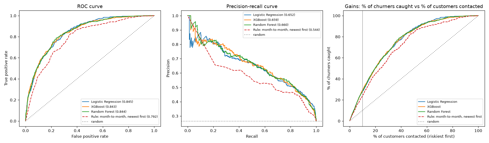
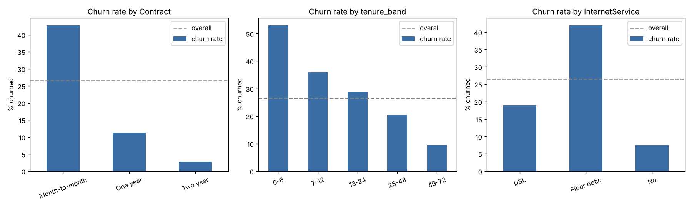
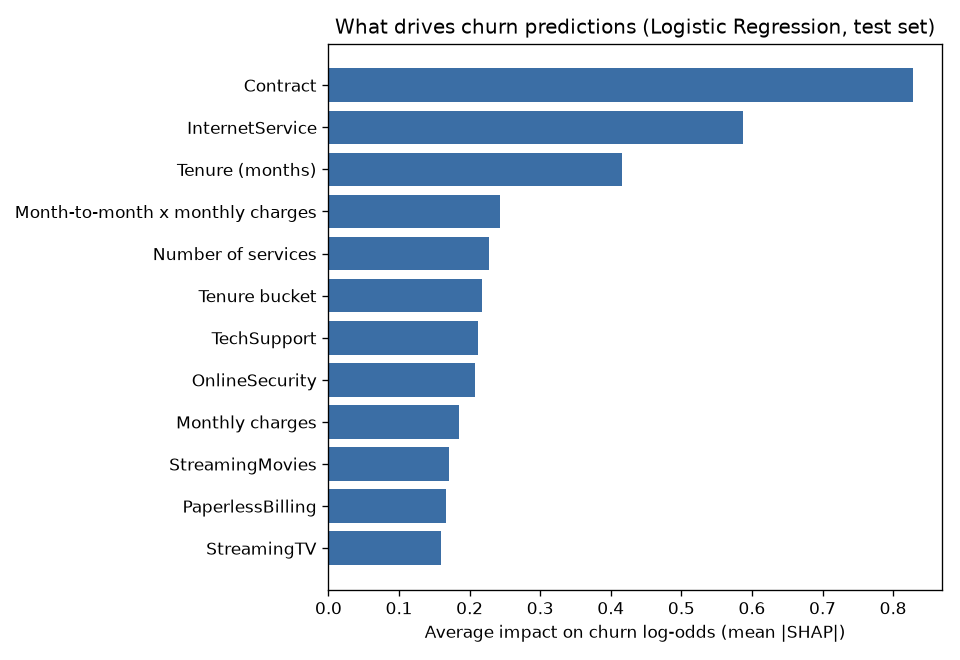

# Customer Churn Prediction

**Flag telecom customers who are about to cancel, explain why, and serve the score through an API, so a retention team can call the right people first.**



## Results at a glance
| | |
|---|---|
| Test ROC-AUC | **0.845** (cross-validation 0.847, so no overfitting) |
| Test PR-AUC | **0.652** (random baseline 0.265) |
| Top 10% riskiest customers | contain **28% of all churners**; **74.5%** of them actually churn (**2.8× lift**) |
| vs. rule-based baseline | catches half of all churners with **~16% fewer calls** than "month-to-month, newest first" |
| Deployment | FastAPI + Docker, returns score, risk tier and top 3 reasons; every prediction logged to SQLite |

## The business problem
A telecom company loses about 1 in 4 customers. Keeping a customer is much cheaper than winning a new one, but a retention team can only contact a fraction of the base. The question is not "will this customer churn?" but **"who should we call first, and what should we say?"**

That framing drives every choice below: ranking metrics instead of accuracy, a capacity-based risk tier, and per-customer reasons the team can act on.

## Data
[IBM Telco Customer Churn](https://github.com/IBM/telco-customer-churn-on-icp4d): 7,043 customers, 20 features (contract, tenure, services, billing, demographics), label `Churn` (26.5% yes).

## What the data shows


- **Contract:** month-to-month churn is 42.7%, two-year 2.8%.
- **Tenure:** 52.9% churn in the first 6 months vs 9.5% after 4 years.
- **Fiber optic** (41.9%), **electronic check** (45.3%), **no tech support** (41.6%) are all high-risk.
- **Data quality:** 11 blank `TotalCharges` values all belong to tenure-0 customers, so they're set to 0 (not mean-imputed).

## Approach
1. **Clean and split:** stratified 80/20 train/test. The test set was scored only once, at the end.
2. **Feature engineering** (`src/features.py`), one function shared by training and the API:
   - tenure buckets, number of services, auto-pay flag
   - fiber without tech support (49% churn vs 16%)
   - month-to-month × monthly charges interaction
   - bill vs lifetime average: a price-change proxy, since the dataset has no monthly usage history
3. **Models:** Logistic Regression, Random Forest, XGBoost, all with **class weights** for the 26.5/73.5 imbalance, compared by 5-fold stratified CV.

| Model | CV ROC-AUC | CV PR-AUC |
|---|---|---|
| **Logistic Regression** | **0.847 ± 0.011** | **0.661 ± 0.015** |
| Random Forest | 0.846 ± 0.009 | 0.658 ± 0.024 |
| XGBoost | 0.846 ± 0.009 | 0.661 ± 0.018 |

**Model choice:** the three are statistically tied (differences < 1 std). I chose **Logistic Regression** as the simplest, fastest and most explainable model within one standard deviation of the best. Gradient boosting doesn't always win, and on mostly additive signal it shouldn't.

## Evaluation against a baseline
A retention team without a model might call month-to-month customers, newest first. Compared with that rule on the test set:

| | Model | Rule |
|---|---|---|
| ROC-AUC | 0.845 | 0.792 |
| Precision in top 10% | 74.5% | 64.5% |
| Calls needed to catch 50% of churners | **279** | 334 |

**Honest framing:** the model doesn't find churners a rule could never find. Its value is **ranking**: with limited call capacity it reaches the same churners with about 16% less effort, and its call list is more accurate.

## Explainability (SHAP)


Contract, internet service and tenure dominate. The engineered month-to-month × charges feature ranks 4th. Every API response includes the top 3 reasons, for example:

> P(churn) = 0.88, **high** risk, because of a month-to-month contract, tenure of 1 month and fiber optic

This lets the team pick an action: offer a 1-year contract discount, or a free tech-support trial.

*Caveat: SHAP explains the model, not causation, and correlated features (tenure, total charges) share credit.*

## Deployment
```
docker build -t churn-api .
docker run -p 8000:8000 -v churn-data:/data churn-api
# open http://localhost:8000/docs
```
| Endpoint | Purpose |
|---|---|
| `POST /predict` | churn probability, risk tier (high/medium/low), top reasons |
| `GET /health` | liveness check |
| `GET /monitoring/summary` | prediction count, average risk, average bill, tier mix (drift check) |

Design notes:
- **Risk tiers by rank, not 0.5.** Class weights inflate probabilities (0.5 would flag ~40% of customers), so the top 10% of the training-score distribution is "high" and the next 20% "medium", matching a realistic call capacity.
- **Input validation** with Pydantic: an invalid value like "month to month" returns a 422 error, not a silently wrong score.
- **Prediction log** in SQLite on a Docker volume, for drift monitoring. If the share of "high" customers moves well away from 10%, or average bills shift, it's time to retrain.
- **Pinned library versions** so the saved model always loads identically.

<details>
<summary>Example request / response</summary>

```
curl -X POST localhost:8000/predict -H "Content-Type: application/json" -d '{
  "customerID": "demo-001", "gender": "Female", "SeniorCitizen": "No", "Partner": "No",
  "Dependents": "No", "tenure": 1, "PhoneService": "Yes", "MultipleLines": "No",
  "InternetService": "Fiber optic", "OnlineSecurity": "No", "OnlineBackup": "No",
  "DeviceProtection": "No", "TechSupport": "No", "StreamingTV": "No", "StreamingMovies": "No",
  "Contract": "Month-to-month", "PaperlessBilling": "Yes", "PaymentMethod": "Electronic check",
  "MonthlyCharges": 74.4, "TotalCharges": 74.4}'
```
```
{"customerID": "demo-001", "churn_probability": 0.8845, "risk_tier": "high",
 "top_reasons": [{"feature": "Contract", "value": "Month-to-month", "impact": 0.742},
                 {"feature": "Tenure (months)", "value": 1.0, "impact": 0.597},
                 {"feature": "InternetService", "value": "Fiber optic", "impact": 0.597}],
 "model": "logistic_regression"}
```
</details>

## Reproduce
```
pip install -r requirements.txt
python src/eda.py              # exploration + charts
python -m src.data_prep        # clean + split
python -m src.train            # train + 5-fold CV
python -m src.evaluate         # test-set evaluation vs baseline
python -m src.explain          # SHAP
python -m src.export_serving   # risk-tier cut-offs for the API
pytest tests                   # API tests (5)
uvicorn app.main:app --reload  # run the API locally
```

## Project structure
```
data/raw/            original CSV
data/processed/      train.csv, test.csv
src/                 eda, data_prep, features, train, evaluate, explain, export_serving
app/                 FastAPI app, request schemas, SQLite logging
models/              trained pipelines + serving config
reports/figures/     charts
tests/               API tests
NOTES_step*.md       detailed write-up of each step
Dockerfile
```

## Limitations and next steps
- **A single snapshot, not a time series.** There's no monthly usage history, so true usage-trend features and a time-based split weren't possible. With real data I'd train on earlier months and test on later ones.
- **Probabilities aren't calibrated** because of class weights. If the business needs "expected churners" rather than a ranking, add Platt/isotonic calibration.
- **Cost-based threshold:** with real retention-offer costs and customer lifetime value, choose the call-list size that maximises expected profit.
- **Uplift modelling:** the real goal is customers who would stay *because* of a call, not just those likely to leave.
